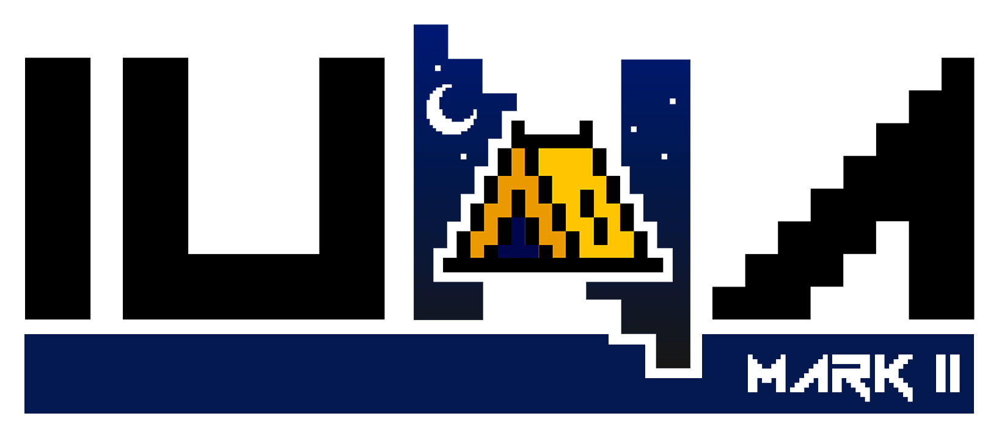

  <picture>
    <source media="(prefers-color-scheme: dark)" srcset="assets/iuna-wordmark-dark.png" />
    
  </picture>

  A Brazilian Minecraft community made for friends — and yes, we <i>“don’t have a name”</i>.

  
  
  

  <a href="https://github.com/IunaMC">Português</a> · <b>English</b>

---

## About

**I.U.N.A** is a modded Minecraft server run by and for a group of friends. We
play on our own **NeoForge 1.21.1** modpack, built around tech, magic,
exploration and cooking — Create, Applied Energistics 2, Ars Nouveau,
Apotheosis and plenty more.

The server is private and open only to members of our Discord community. Even
so, everything that can be public lives here on GitHub: the mod list, the
changelog and a place for the community to report problems and suggest ideas.

## Get the modpack

- **CurseForge:** [pack page](https://www.curseforge.com/projects/1752945).
  Install it with the CurseForge app or Prism Launcher (*Add Instance →
  CurseForge*).
- **`.mrpack` file:** [iuna.club/mrpack](https://iuna.club/mrpack) always
  downloads the latest version. Import it in Prism Launcher (*Add Instance →
  Import*) or the Modrinth App (*Import from file*).
- **All versions and the changelog:** [modpack releases](https://github.com/IunaMC/modpack/releases).

Step-by-step instructions (in Portuguese) are in the
[modpack README](https://github.com/IunaMC/modpack#instalação).

## Repositories

| Repository | What it is for |
| :-- | :-- |
| [**modpack**](https://github.com/IunaMC/modpack) | The modpack, for players and the server: mod list, changelog and releases. |
| [**issues**](https://github.com/IunaMC/issues) | Bugs, mod suggestions, requests and improvements from the community. |

## Get involved

- **Found a bug or want to suggest a mod?** Open an issue at
  [IunaMC/issues](https://github.com/IunaMC/issues/issues).
- **Want to know what changed?** Check the
  [modpack changelog](https://github.com/IunaMC/modpack/blob/main/MUDANCAS.md).
- **Anything else:** [contato@iuna.club](mailto:contato@iuna.club).

Made with care in Brazil 🇧🇷

